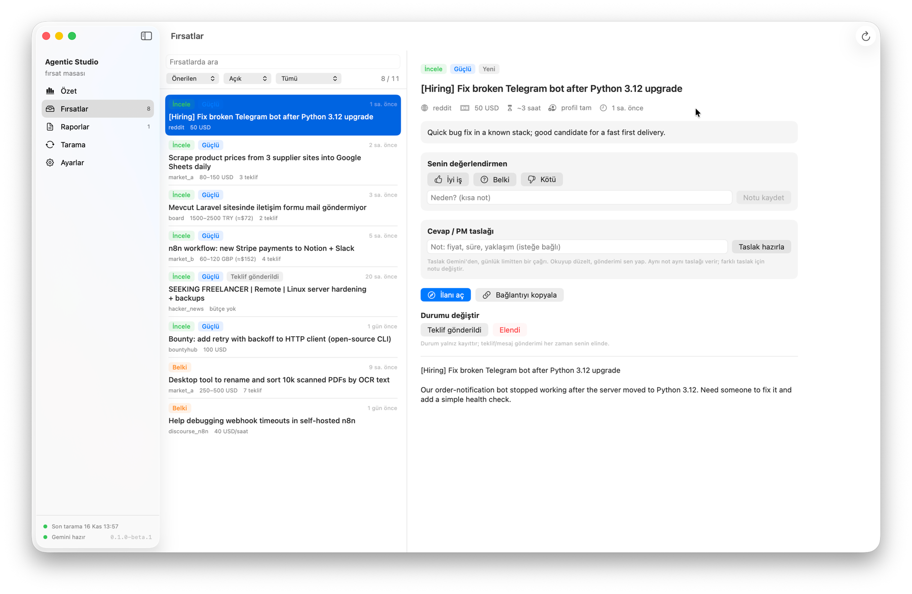
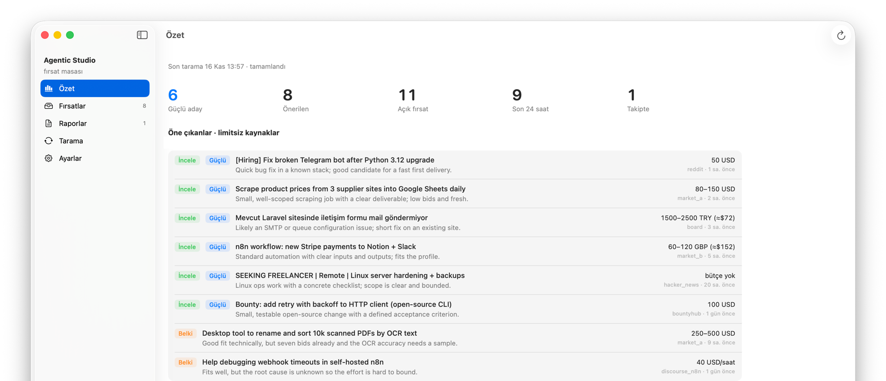
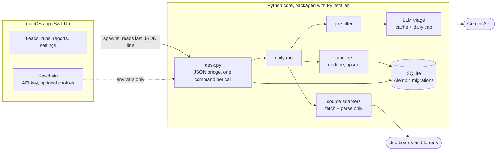

# Agentic Studio

  
  
  
  
  
  

Finding paid freelance work means reading the same job boards every few hours and throwing most of it away.

**Agentic Studio reads the boards for me and leaves the decisions to me.** It collects new listings from nine sources, removes duplicates, filters out what clearly does not fit, asks an LLM for a short verdict on the rest, and shows the result in a small macOS app. Nothing is ever sent from it: proposals and messages are written and sent by a person.

I built it on my own. It is a personal tool, in daily use and still evolving.

> **This is the public window into a private repository.** The LLM prompts, the marketplace adapters and the internal notes stay private, and the marketplaces are not named. Everything else under [`source/`](source/) is a copy of real files from that repository.

  

Screenshots use made-up listings; the marketplace names are replaced with neutral ones, as in the code.

## By the numbers

| 238 | 765 | ~5k | ~5k | ~2k | 9 |
|:---:|:---:|:---:|:---:|:---:|:---:|
| commits | automated tests | lines of Python | lines of tests | lines of Swift | sources |

7 to 19 October 2026, on the main branch. Every change ran through Ruff, strict mypy and pytest in CI.

## What it does

1. **Collect.** Adapters read two freelance marketplaces, a community forum, Reddit hiring feeds, Hacker News freelancer threads, two Discourse communities and GitHub-based bounty platforms. All of them anonymously, read-only, with bounded requests.
2. **De-duplicate.** Every listing gets a stable, versioned source identity. Seeing the same listing again refreshes its evidence without touching anything a person has decided about it.
3. **Pre-filter.** Hard rules drop what is closed, out of scope or already over-bid, before any money is spent on an LLM call.
4. **Triage.** Gemini returns `review`, `maybe` or `reject` with reasons, an effort estimate and a profile-fit level. Calls are cached and capped per day by a crash-safe spend ledger.
5. **Decide.** The macOS app shows what is worth reading. Each lead can be labelled good / maybe / bad with a note; those labels are the evaluation set the triage is measured and tuned against.
6. **Track.** `new → proposal sent → won / lost → delivered`, enforced by an explicit transition table.

  

A full scan runs on the first launch of the day; while the app is open, a quick scan of the fastest-moving sources runs every 15 minutes and posts a notification for new leads worth reading.

## Under the hood

The decisions that shaped it:

1. **The app holds no business logic.** The SwiftUI app spawns one bundled Python executable per command and reads a single JSON reply. Every rule lives in Python, where it is tested; the UI only renders and asks.
2. **Adapters fetch and parse, nothing else.** A source adapter yields records or permanent rejections and raises a transient failure when a retry makes sense. It never scores, filters or stores. Adding a source is one file and one test file.
3. **Identity is explicit and versioned.** Deduplication hashes `[source, kind, id]` as a JSON array, falls back to a normalised URL when there is no id, and stores the version with the key so the algorithm can change without breaking old rows.
4. **Predictions never overwrite facts.** LLM output is a prediction record next to the listing. It cannot change a lead's status; only a person can, through the lifecycle table.
5. **Spending is capped before it happens.** Each LLM call reserves budget in a durable, fsync'd ledger first. A crash cannot lose a reservation, and a busy concurrent run fails closed instead of spending twice.

## A tour of the code

- **Domain contract.** Frozen, strict Pydantic models with no extra fields, and the same contract written down as a schema. → [`domain.py`](source/src/agenticstudio/domain.py) · [`schemas/opportunity.yaml`](source/schemas/opportunity.yaml) · [`lifecycle.py`](source/src/agenticstudio/lifecycle.py)
- **Ingestion contract.** One attempt materialises a whole batch or nothing; the caller owns retries and checkpoints. → [`ingestion/__init__.py`](source/src/agenticstudio/ingestion/__init__.py) · [`runtime/__init__.py`](source/src/agenticstudio/runtime/__init__.py)
- **Source adapters.** JSON APIs, Atom feeds and plain HTML, each bounded and tested against recorded responses. → [`sources/`](source/src/agenticstudio/sources/) · e.g. [`hacker_news.py`](source/src/agenticstudio/sources/hacker_news.py), [`reddit.py`](source/src/agenticstudio/sources/reddit.py), [`discourse.py`](source/src/agenticstudio/sources/discourse.py), [`bountyhub.py`](source/src/agenticstudio/sources/bountyhub.py)
- **Deduplication and upsert.** → [`dedupe/__init__.py`](source/src/agenticstudio/dedupe/__init__.py) · [`pipeline.py`](source/src/agenticstudio/pipeline.py) · [`tests/test_dedupe.py`](source/tests/test_dedupe.py)
- **Storage.** SQLite behind a repository interface, with explicit transactions and Alembic migrations. → [`persistence/`](source/src/agenticstudio/persistence/)
- **LLM plumbing.** Structured-output calls, the spend ledger and its tests. → [`evaluation/gemini.py`](source/src/agenticstudio/evaluation/gemini.py) · [`evaluation/shadow.py`](source/src/agenticstudio/evaluation/shadow.py) · [`tests/test_gemini_shadow.py`](source/tests/test_gemini_shadow.py)
- **App bridge.** → [`desk.py`](source/src/agenticstudio/desk.py) · [`BackendService.swift`](source/macos/Sources/BackendService.swift) · [`build-macos.sh`](source/macos/build-macos.sh)
- **CI.** Ruff, strict mypy and pytest on every push and pull request. → [`ci.yml`](source/.github/workflows/ci.yml)

## Stack

| Layer | Tools |
|:---|:---|
| **Core** | Python 3.12, Pydantic 2, SQLAlchemy 2, Alembic, SQLite, Google Gen AI SDK (Gemini) |
| **App** | SwiftUI on macOS, Keychain, user notifications, the core bundled with PyInstaller |
| **Quality** | pytest, Ruff, mypy in strict mode, GitHub Actions |
| **Development** | Claude Code |

## In this repository

| Path | Content |
|:---|:---|
| [`source/`](source/) | Curated copy of real files from the private repository ([what is left out](source/README.md)) |
| [`media/`](media/) | Screenshots of the app with made-up data |

The code is published to be read; it is not licensed for reuse. Agentic Studio is a personal tool and is not affiliated with any of the platforms it reads.

---

Designed and built by <a href="https://github.com/sercansefunc"><b>Sercan Sefunc</b></a>

